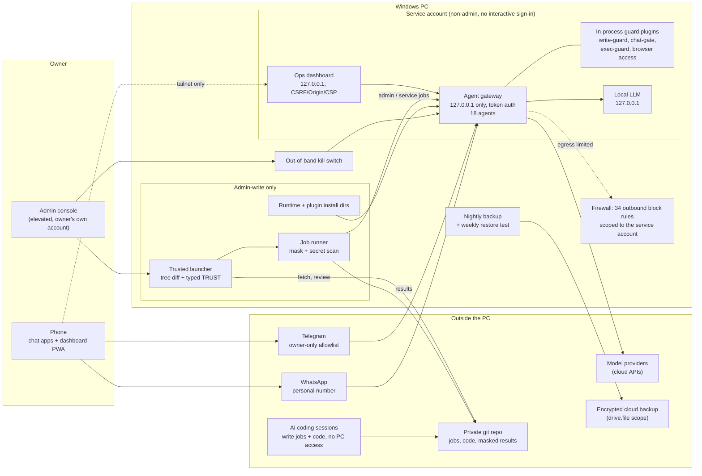
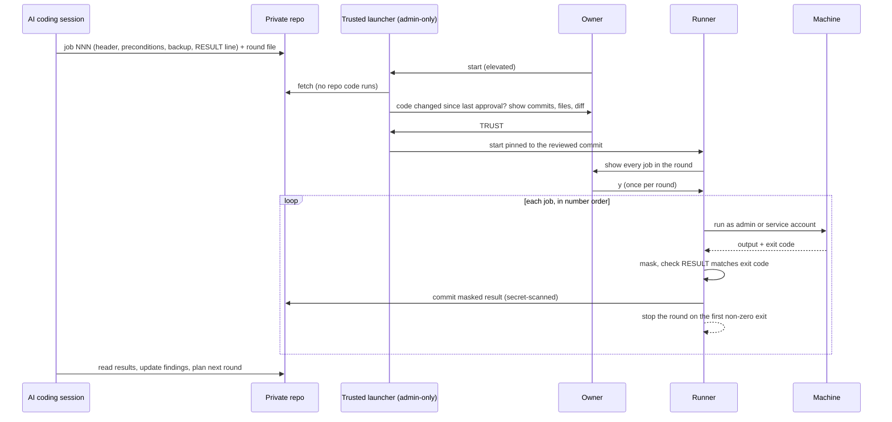

# Architecture

One Windows PC runs the agent platform and a local operations dashboard as Windows services under a dedicated non-admin service
account. The operator reaches it from a phone (chat channels, and a phone dashboard over a private tailnet). Changes to the machine
never happen by hand: they go through a reviewed job pipeline.

## Trust boundaries

| Boundary | Enforced by | Notes |
|---|---|---|
| Internet -> gateway | Loopback bind, token auth, login rate limit; remote access only over a private tailnet | No public listener. The platform's own exposure checks pass. |
| Chat senders -> agents | Telegram: owner-only allowlist for DMs, groups and commands. WhatsApp: config admission list plus the chat-gate plugin (trigger word per chat, owner-only commands, fail closed) | The owner's messaging accounts are the root credential, so their MFA is a control in its own right. |
| Agent -> tools | Per-agent tool policy (deny lists), exec approvals with pinned argument patterns, write-guard, per-topic browser switch | 5 of 18 agents keep shell exec (approval-gated); none keep config/gateway tools. |
| Service account -> host | Non-admin, no interactive or RDP logon, admin-only install dirs for everything it executes, rebuilt ACLs on its state | One account still holds every agent's secrets: accepted residual risk, see threat model. |
| Service account -> network | Per-program outbound block rules, blocked-connection logging, Defender ASR rules and network protection | Loopback traffic is never matched. |
| Repo -> machine | Trusted launcher outside the repo, job review, one approval per round, auto-stop on first failure, chained OK guards on downtime rounds | AI sessions can push code; only the owner's typed approval runs it. |
| Machine -> repo | Mandatory masking library + secret scanner on every result before commit; the config mirror keeps persona files only | Personal data was mirrored early on; the mirror was cut back to an allowlist. |

## Change pipeline in one picture

## Components

- **Agent gateway**: open-source multi-agent gateway, Node.js, Windows service. 18 configured agents (14 conversational, 4 internal helpers), two chat channels, cloud models
  plus a local model on loopback.
- **Guard plugins**: in-process TypeScript hooks (`before_tool_call`, `before_dispatch`). Installed into admin-write-only,
  versioned folders; SHA-256 baseline recorded.
- **Ops dashboard**: Python standard library + vanilla JS single-page app, loopback only; Host-header, Origin and CSRF checks,
  strict CSP, HttpOnly SameSite=Strict cookie, constant-time token compare. Phone version over the tailnet with a passkey
  step-up for dangerous actions.
- **Ops tooling**: PowerShell (works on Windows PowerShell 5.1 and PowerShell 7), POSIX shell checks, a commit gate that lints
  jobs (rules such as ASCII-only, header present, no unsafe recursive ACL resets, downtime jobs chained) and scans for secrets.
